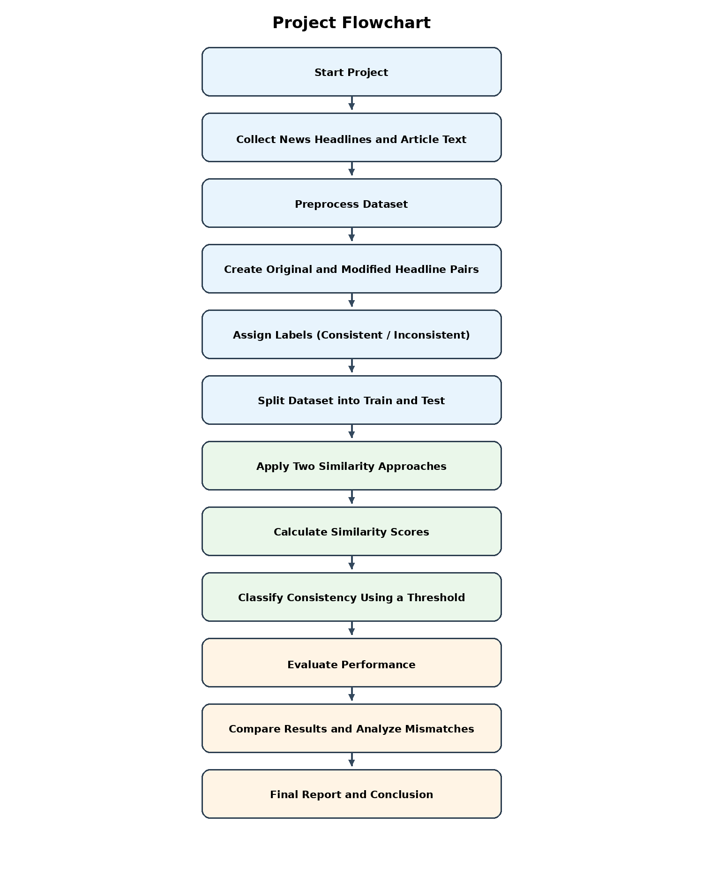
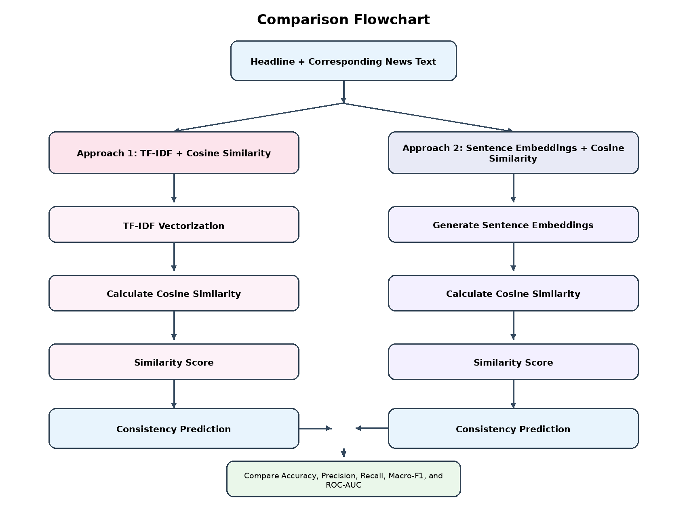

# AI Headline Consistency Detection

AI-based system for detecting semantic inconsistencies between news headlines and their corresponding news text using **TF-IDF, Cosine Similarity, and Sentence Embeddings**.

## Project Overview

Misleading or clickbait headlines can misrepresent the content of a news article. This project develops and compares two NLP-based approaches for determining whether a headline is semantically consistent with its corresponding article text.

### Approaches Compared

1. **TF-IDF + Cosine Similarity**
   - Traditional word-based text representation.
   - Measures similarity using TF-IDF vectors and cosine similarity.

2. **Sentence Embeddings + Cosine Similarity**
   - Modern semantic representation.
   - Converts headlines and article text into dense sentence vectors.
   - Measures semantic similarity using cosine similarity.

The experiment also includes deliberately modified headlines to test the detection of subtle mismatches.

## Objectives

- Detect semantic consistency between headlines and news text.
- Compare traditional and embedding-based similarity approaches.
- Test the approaches using modified or misleading headlines.
- Evaluate the models using standard classification and ranking metrics.
- Analyze strengths and limitations of lexical versus semantic similarity.

## Evaluation Metrics

- Accuracy
- Precision
- Recall
- Macro-F1
- ROC-AUC

> **Note:** ROC-AUC should be calculated using continuous similarity scores or another continuous prediction score rather than only binary class labels.

## Project Flowchart



## Comparison Flowchart



## Suggested Technology Stack

- Python
- Pandas
- NumPy
- Scikit-learn
- Sentence Transformers
- Matplotlib
- Jupyter Notebook

## Example Headline Modifications

- Negation changes: `approved` → `not approved`
- Entity substitution: `India` → `China`
- Number modification: `10%` → `90%`
- Event reversal: `won` → `lost`
- Time changes: `today` → `next year`
- Context reversal: `increased` → `decreased`

## Repository Structure

```text
ai-headline-consistency-detection/
│
├── data/
│   ├── raw/
│   └── processed/
│
├── notebooks/
│   └── headline_consistency_analysis.ipynb
│
├── src/
│   ├── preprocessing.py
│   ├── tfidf_similarity.py
│   ├── embedding_similarity.py
│   └── evaluation.py
│
├── results/
│   ├── metrics/
│   └── visualizations/
│
├── project-flowchart.png
├── comparison-flowchart.png
├── requirements.txt
└── README.md
```

## Expected Outcome

The project will provide a comparative analysis of:

- Lexical similarity using TF-IDF.
- Semantic similarity using sentence embeddings.
- Performance on original headline–article pairs.
- Robustness against deliberately modified headlines.
- Differences in Accuracy, Precision, Recall, Macro-F1, and ROC-AUC.

## Academic Context

**Assignment 14:** Misleading or clickbait headlines are common on news and social-media platforms. The project compares a traditional text-similarity method with a modern embedding-based method to determine whether a headline is semantically consistent with its corresponding news text.
